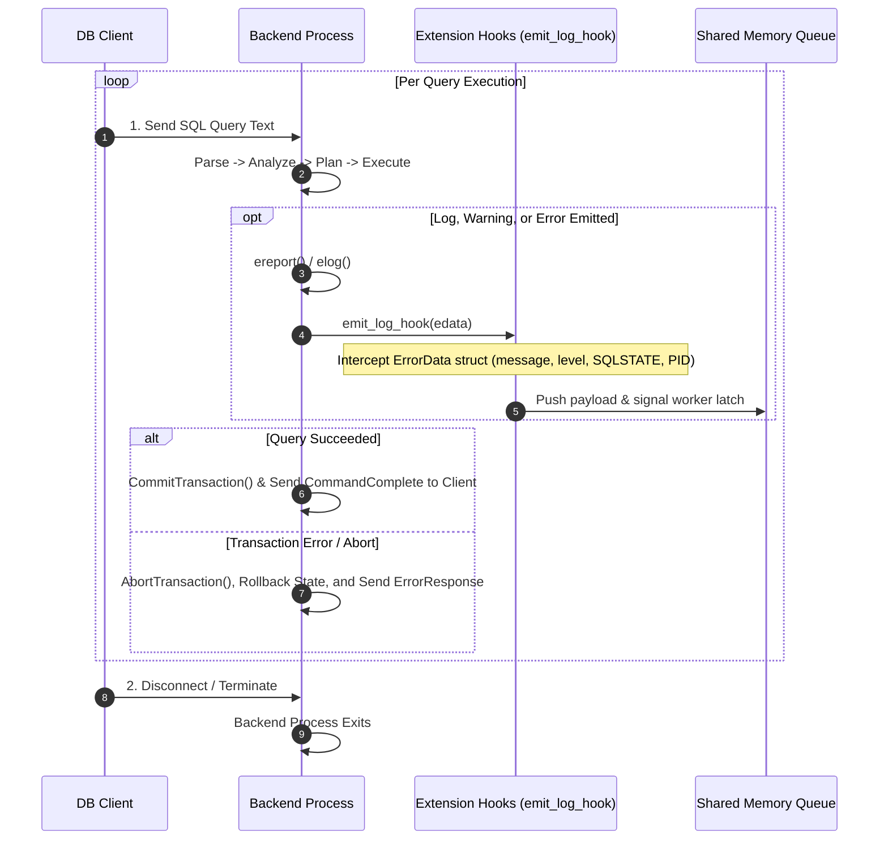

# PostgreSQL Query Processing and SQL Hook Execution Matrix

This document provides a technical reference for query execution lifecycles, diagnostic error/log hooks, and the exact invocation sequence of extension hooks across SQL commands.

---

## Query Processing & Diagnostic Hooks

### Backend Lifecycles & Diagnostic Hooks

- **Query Lifecycle**: Queries transition through `Parse` $\rightarrow$ `Analyze` $\rightarrow$ `Plan` $\rightarrow$ `Execute` $\rightarrow$ `Commit`/`Abort`.
- **`emit_log_hook`**: Executed whenever PostgreSQL's internal `ereport()` or `elog()` macros write a log, warning, error, or debug message.
  Extensions can inspect or suppress `ErrorData` fields (e.g. SQLSTATE, error message, severity, line number).
- **Transaction Aborts**: (`ERROR` / `FATAL`) When a transaction fails, PostgreSQL aborts the transaction and rolls back database state.
  Shared memory writes (IPC queues) are independent of database transaction rollbacks and remain intact.
- **Backend Crashes**: (SIGSEGV / Panic) If a backend process crashes, Postmaster catches `SIGCHLD`, sends `SIGQUIT` to all other backends to stop execution, resets shared memory, and runs crash recovery.

---

## Transaction Lifecycles & Statement Grouping

A PostgreSQL client backend has at most **one top-level transaction** active at any given moment. Every SQL statement executes inside a transaction:

### 1. Single-Statement Autocommit
When a client is idle and sends a single statement, PostgreSQL starts a transaction, runs the statement, and immediately commits it before returning `ReadyForQuery`.
`xact_callback` fires at the end of that statement.

### 2. Multi-Statement Simple Query ('Q')
When a client sends multiple semicolon-separated statements in a single Simple Query string:
- If not already in an explicit `BEGIN` block, PostgreSQL enters an **implicit transaction block**.
- All statements in the string share the **same transaction** and commit atomically (or all roll back together).
- `xact_callback` does **not** fire between ordinary statements in the batch; only when the transaction commits or aborts.
- **Mid-Batch Transaction Boundaries**: If the multi-statement string contains explicit `BEGIN`, `COMMIT`, `ROLLBACK` or commands that cannot run inside a transaction (e.g., `VACUUM`, `CREATE INDEX CONCURRENTLY`), PostgreSQL commits/aborts the transaction and starts a new transaction for the remaining statements.

### 3. Explicit Transaction Blocks (`BEGIN`, `COMMIT`)
- Issuing `BEGIN` (or `START TRANSACTION`) transitions the backend into an **explicit transaction block**.
- Subsequent statements across multiple client round-trips execute inside that **same single transaction**.
- `xact_callback` fires only when `COMMIT`, `END`, `ROLLBACK`, or an unhandled error terminates the transaction block; not after each individual statement inside the block.

### 4. Special Cases & Edge Conditions for Telemetry

- **Subtransactions (`SAVEPOINT` and PL/pgSQL `EXCEPTION`)**:
  A top-level transaction can push a nested stack of subtransactions via SQL `SAVEPOINT` or PL/pgSQL `BEGIN ... EXCEPTION` blocks.
  Subtransactions do **not** fire `xact_callback`; they fire `subxact_callback`.
- **Inverted Lifetimes (`CALL`, `VACUUM`, `CLUSTER`)**:
  Certain utility commands executed outside an explicit `BEGIN` block can commit the active transaction and start a new one *while `ProcessUtility_hook` is still on the call stack*:
  - Stored procedures invoked via `CALL` can execute `COMMIT` or `ROLLBACK` internally.
  - Maintenance commands like `VACUUM` and `CLUSTER` start and commit multiple independent transactions sequentially across relations or phases.
  - Consequently, `xact_callback` can fire **one or more times inside** a single `ProcessUtility_hook` invocation.
- **Multiple Open Portals (Cursors and Extended Query Protocol)**:
  A client can interleave partial `FETCH` or Extended Query Protocol `Execute` messages (with row limits) across multiple open portals/cursors simultaneously.
  However, all open portals still execute sequentially within the **same single active transaction**.
- **Rollback in Aborted Transactions (`TBLOCK_ABORT`)**:
  When a statement inside an explicit transaction block fails with an error, PostgreSQL immediately calls `AbortTransaction()` and triggers `xact_callback(XACT_EVENT_ABORT)`.
  The backend enters `TBLOCK_ABORT` (*"current transaction is aborted, commands ignored until end of transaction block"*).
  When the client subsequently sends `ROLLBACK`, PostgreSQL executes `CleanupTransaction()` to reset state, but **does not fire `xact_callback` a second time**.

---

## SQL Hook Execution Matrix

The following tables map each SQL command to the hooks it triggers when executed as a **standalone autocommit statement**. Numbers indicate the order hooks are called, while a dash indicates the hook is not called. (Inside an explicit `BEGIN ... COMMIT` block or multi-statement batch, `xact_callback` is deferred until the transaction itself ends.)

### Utility Commands

These trigger `post_parse_analyze_hook`, `process_utility_hook`, and `xact_callback`.

| SQL Command | `post_parse_analyze_hook` | `process_utility_hook` | `planner_hook` | `executor_start_hook` | `executor_run_hook` | `xact_callback` |
| :---------- | :-----------------------: | :--------------------: | :------------: | :-------------------: | :-----------------: | :-------------: |
| **ALTER …**                   | 1 | 2 | - | - | - | 3 |
| **ANALYZE**                   | 1 | 2 | - | - | - | 3 |
| **CALL**                      | 1 | 2 | - | - | - | 3 |
| **CLOSE**                     | 1 | 2 | - | - | - | 3 |
| **CLUSTER**                   | 1 | 2 | - | - | - | 3 |
| **COMMENT**                   | 1 | 2 | - | - | - | 3 |
| **DISCARD**                   | 1 | 2 | - | - | - | 3 |
| **DO**                        | 1 | 2 | - | - | - | 3 |
| **DROP …**                    | 1 | 2 | - | - | - | 3 |
| **GRANT**                     | 1 | 2 | - | - | - | 3 |
| **IMPORT FOREIGN SCHEMA**     | 1 | 2 | - | - | - | 3 |
| **LISTEN**                    | 1 | 2 | - | - | - | 3 |
| **LOAD**                      | 1 | 2 | - | - | - | 3 |
| **LOCK**                      | 1 | 2 | - | - | - | 3 |
| **MOVE**                      | 1 | 2 | - | - | - | 3 |
| **NOTIFY**                    | 1 | 2 | - | - | - | 3 |
| **REASSIGN OWNED**            | 1 | 2 | - | - | - | 3 |
| **REINDEX**                   | 1 | 2 | - | - | - | 3 |
| **RESET**                     | 1 | 2 | - | - | - | 3 |
| **REVOKE**                    | 1 | 2 | - | - | - | 3 |
| **SECURITY LABEL**            | 1 | 2 | - | - | - | 3 |
| **SET**                       | 1 | 2 | - | - | - | 3 |
| **SET CONSTRAINTS**           | 1 | 2 | - | - | - | 3 |
| **SET ROLE**                  | 1 | 2 | - | - | - | 3 |
| **SET SESSION AUTHORIZATION** | 1 | 2 | - | - | - | 3 |
| **SHOW**                      | 1 | 2 | - | - | - | 3 |
| **TRUNCATE**                  | 1 | 2 | - | - | - | 3 |
| **UNLISTEN**                  | 1 | 2 | - | - | - | 3 |
| **VACUUM**                    | 1 | 2 | - | - | - | 3 |

### Transaction Commands

Transaction statements bypass `post_parse_analyze_hook` and execute directly via `process_utility_hook`.

| SQL Command | `post_parse_analyze_hook` | `process_utility_hook` | `planner_hook` | `executor_start_hook` | `executor_run_hook` | `xact_callback` |
| :---------- | :-----------------------: | :--------------------: | :------------: | :-------------------: | :-----------------: | :-------------: |
| **ABORT**               | - | 1 | - | - | - | 2 |
| **BEGIN**               | - | 1 | - | - | - | 2 |
| **CHECKPOINT**          | - | 1 | - | - | - | 2 |
| **COMMIT …**            | - | 1 | - | - | - | 2 |
| **END**                 | - | 1 | - | - | - | 2 |
| **PREPARE TRANSACTION** | - | 1 | - | - | - | 2 |
| **RELEASE SAVEPOINT**   | - | 1 | - | - | - | 2 |
| **ROLLBACK …**          | - | 1 | - | - | - | 2 |
| **SAVEPOINT**           | - | 1 | - | - | - | 2 |
| **SET TRANSACTION**     | - | 1 | - | - | - | 2 |
| **START TRANSACTION**   | - | 1 | - | - | - | 2 |

### DML and Queries

| SQL Command | `post_parse_analyze_hook` | `process_utility_hook` | `planner_hook` | `executor_start_hook` | `executor_run_hook` | `xact_callback` |
| :---------- | :-----------------------: | :--------------------: | :------------: | :-------------------: | :-----------------: | :-------------: |
| **COPY … FROM**               | 1 | 2 | - | - | - | 3 |
| **COPY … TO**                 | 1 | 2 | - | - | - | 3 |
| **COPY (query) TO**           | 1 | 2 | 3 | 4 | 5 | 6 |
| **CREATE …**                  | 1 | 2 | - | - | - | 3 |
| **CREATE MATERIALIZED VIEW**  | 1 | 2 | 3 | 4 | 5 | 6 |
| **CREATE TABLE AS**           | 1 | 2 | 3 | 4 | 5 | 6 |
| **CREATE VIEW**               | 1 | 2 | - | - | - | 3 |
| **DEALLOCATE**                | 1 | 2 | - | - | - | 3 |
| **DECLARE**                   | 1 | 2 | 3 | 4 | - | 5 |
| **DELETE**                    | 1 | - | 2 | 3 | 4 | 5 |
| **EXECUTE**                   | 1 | 2 | - (cached) | 3 | 4 | 5 |
| **EXPLAIN**                   | 1 | 2 | 3 | 4 | - | 5 |
| **EXPLAIN (ANALYZE)**         | 1 | 2 | 3 | 4 | 5 | 6 |
| **FETCH**                     | 1 | 2 | - | - | 3 | 4 |
| **INSERT**                    | 1 | - | 2 | 3 | 4 | 5 |
| **MERGE**                     | 1 | - | 2 | 3 | 4 | 5 |
| **PREPARE**                   | 1 | 2 | - | - | - | 3 |
| **REFRESH MATERIALIZED VIEW** | 1 | 2 | 3 | 4 | 5 | 6 |
| **SELECT**                    | 1 | - | 2 | 3 | 4 | 5 |
| **SELECT INTO**               | 1 | 2 | 3 | 4 | 5 | 6 |
| **UPDATE**                    | 1 | - | 2 | 3 | 4 | 5 |
| **VALUES**                    | 1 | - | 2 | 3 | 4 | 5 |
